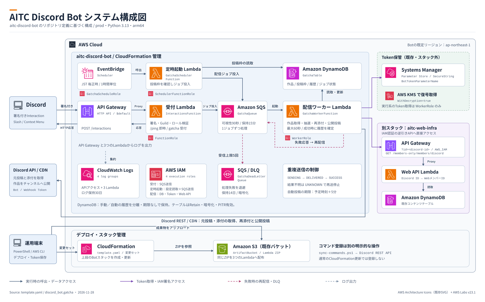

# AITC Discord Bot

指定したDiscordサーバーの `/ping` と `/gatcha` を、API Gateway HTTP APIとPython 3.13／arm64 Lambdaで処理します。`/ping` は本人だけへの `Pong!`、`/gatcha draw` はAITCの登録作品の公開投稿です。prod一環境をCloudFormationとPowerShellで管理します。

[設計書](docs/design.md) に構成、署名検証、権限、移行と受入条件をまとめています。署名検証は既存の `aitc-auth-api` と同じ `cryptography==50.0.2` の Ed25519 を使用します。受付Lambdaは署名を検証して配信ジョブをSQSへ投入します。ワーカーはDynamoDBで作品・設定・独立した履歴を管理し、Parameter Storeから取得したBot TokenでDiscord APIを呼びます。定時投稿は1時間ごとのEventBridge Schedulerで起動します。

[gatchaの仕様・コマンド・導入手順](docs/gatcha.md) に、管理者ロール、登録元チャンネル、JSTの投稿枠、IAM認証のWeb逆引きAPI、失敗時の扱いをまとめています。

## システム構成



[AWSリソースの関係と管理範囲](docs/system-architecture.md) ／ [PNG版](docs/system-architecture.png)

## ローカル検証

PowerShell 7.4 以降、uv、Python 3.13 を使います。AWS CLI v2 はデプロイと Discord コマンド管理で必要です。

```powershell
.\scripts\test.ps1
.\scripts\build.ps1
```

テストは実際の Ed25519 署名と、AWS・Discord 呼び出しのモックを使います。AWS や Discord の実環境を変更しません。ビルドは固定した Linux arm64 向けの依存を使い、`dist/lambda-<SHA256>.zip` を出力します。ZIP の配置・ネイティブライブラリ・固定バージョンは次のコマンドで確認できます。

```powershell
uv run --no-project --python 3.13 python .\tests\check_artifact.py <ZIPのパス>
```

## 本番の設定

`config/prod.example.json` を `config/prod.json` にコピーし、値を設定します。実値ファイルは Git の対象外です。Application ID、公開鍵、Guild ID は Developer Portal と Discord から取得します。ID は JSON の文字列として入力してください。

`ArtifactBucket` は同一リージョンの既存 S3 バケットを指定します。`AllowedGuildIds` はコマンドの登録先と Lambda の許可先で共用します。旧 Bot の導入先のうち Bot の所属一覧から取得できないギルドがある場合は、追加設定 `LegacyGuildIds` に全 ID を列挙します。

AWS CLI の対象プロファイルでログインし、Token を扱う前に CLI 履歴を無効にします。

```powershell
aws configure set cli_history disabled --profile <プロファイル>
.\scripts\save-bot-token.ps1
```

Token は非表示入力で受け取り、アクセスを現在のユーザーに限定した一時ディレクトリ経由で Parameter Store の SecureString に保存します。AWS CLI の引数・CloudFormation・Lambda・Git には Token の値を渡しません。既存のパラメーターがある場合は上書きします。

一時ディレクトリの ACL を読み直して確認できない環境では、Token をファイルへ書く前に停止します。その場合は、Windows の通常の PowerShell セッションで実行してください。管理スクリプトの自動テストでは ACL 操作もモックし、確認失敗時の停止と後片付けを検証します。

## 手動デプロイ

次の実行で、テスト・Linux arm64 ビルド・成果物のアップロード・変更セットの作成まで行います。AWS アカウント、リージョン、スタック、変更内容を表示します。

```powershell
.\scripts\deploy.ps1
```

表示された変更セットを確認し、その名前を指定して適用します。同じ変更セットを実行するため、レビュー後にコードを再ビルドして入れ替えることはありません。

```powershell
.\scripts\deploy.ps1 -ExecuteChangeSet <表示された変更セット名>
```

完了まで待機して Outputs を表示します。初回作成用の変更セットはスタックを `REVIEW_IN_PROGRESS` の状態にするため、適用が終わるまでは同じ変更セットを使います。初回適用が失敗して `ROLLBACK_COMPLETE` になった場合は、スタックイベントを調べて復旧方針を決めます。

通常のデプロイは Discord 側の Endpoint URL・コマンド・旧 Bot のプロセスを変更しません。更新時の旧テンプレートと旧パラメーターは `dist/deploy-<ID>/previous-*` に保存されます。以前の ZIP も保持するため、障害時はこれらを使って CloudFormation から前の構成へ戻します。ロググループはスタック削除後も保持します。

## 旧 Bot の切り替え

この節は初期 `/ping` 移行時の手順です。gatcha導入後の更新・復旧は [gatchaの運用手順](docs/gatcha.md#導入更新) に従います。

1. 旧プロセスを停止・再起動できることと旧成果物を確認し、メンテナンス時間を確保します。
2. 全導入先のギルドと既存 Endpoint URL を確認し、登録済みのコマンドと権限をバックアップします。コマンド専用のインストール先は手動でも棚卸しし、必要なら `LegacyGuildIds` を追加して新しいバックアップを取ります。

   ```powershell
   .\scripts\migrate-commands.ps1 -Mode Backup -BackupPath .\backups\before-serverless.json
   ```

3. 旧プロセスと自動再起動を停止し、Developer Portal の Interactions Endpoint URL に Outputs の `InteractionsEndpointUrl` を保存します。署名付き PING の検証に成功することを確認します。
4. バックアップした削除対象と全導入先を確認してから、旧コマンドを廃止します。適用操作には確認プロンプトがあります。

   ```powershell
   .\scripts\migrate-commands.ps1 -Mode Apply -BackupPath .\backups\before-serverless.json -ConfirmGuildInventory
   .\scripts\sync-commands.ps1
   ```

5. 全許可ギルドで一般メンバーの `/ping` を確認します。別メンバーから応答が見えないこと、旧コマンドが残っていないこと、初回起動を含む応答期限を確認します。[受入条件](docs/design.md#実環境での受入条件) を満たして移行完了とします。

移行中の削除記録はバックアップ横の `.state.json` に保存されます。通信切断後は同じバックアップで `Apply` を再実行できます。バックアップ後にコマンド・権限・導入先が変わっていれば停止します。新しい `/ping` の登録は旧コマンドの削除が完了してから実行してください。

切り戻す場合はバックアップの定義を復元します。

```powershell
.\scripts\migrate-commands.ps1 -Mode Restore -BackupPath .\backups\before-serverless.json -ConfirmGuildInventory
```

この操作は新しい `/ping` を除去して旧コマンドの定義を再登録します。無関係なコマンドが追加・変更されていれば停止します。コマンド ID は変わるため、サーバー管理者がバックアップをもとに権限の上書きを Discord の連携サービス設定で再設定します。旧 Endpoint URL の復元または解除と旧プロセスの再起動も手動で行います。

## 運用確認

API と Lambda のログ保持期間は 30 日です。request ID、結果、処理時間を使い、CloudWatch の Errors・Throttles・Duration・API Latency を確認します。受信本文・署名・Token・利用者プロフィールは記録しません。

初期版はオンデマンドで、外部への自動通知はありません。初回起動を含めて API の応答時間 2.5 秒未満を内部目標とし、Discord の 3 秒の初回応答期限を実クライアントで確認します。期限を満たさない場合は移行を完了せず、構成を見直します。Gateway に接続しないため、Bot のオンライン表示を稼働判定に使用しません。
