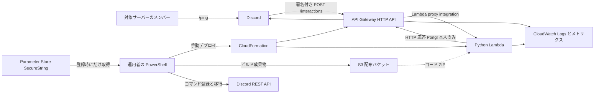
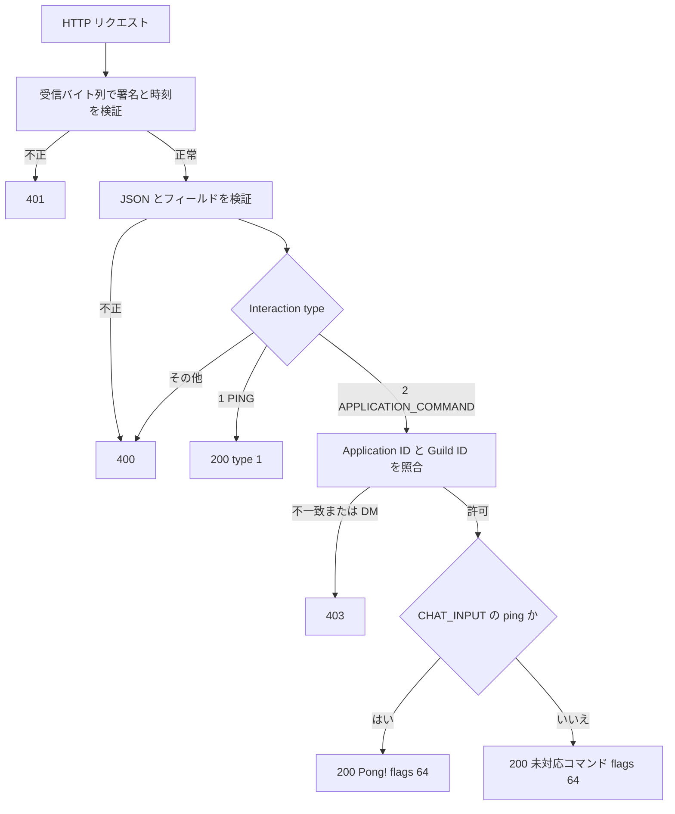

# aitc-discord-bot サーバーレス実行基盤設計

本書は `/ping` 初期版の設計です。issue #3で追加するgatchaコマンド・DynamoDB・SQS・配信ワーカー・Scheduler・実行時Token取得については [gatcha設計と運用](gatcha.md) を参照してください。以下の「DB・キューなし」「実行系のToken取得なし」は初期 `/ping` の範囲を示します。

Slash Command を API Gateway HTTP API と AWS Lambda で処理する。
初期版は指定サーバーの `/ping` のみを提供する。
実装・移行を担当する開発者向けに、処理仕様、インフラ、手動運用、移行と受入条件を定める。

## 決定事項と対象範囲

| 項目               | 方針                                                                       |
| ------------------ | -------------------------------------------------------------------------- |
| 初期機能           | `/ping` のみ。旧機能の移植は後続対応                                       |
| 利用先             | 設定した Discord サーバーのみ。DM は対象外                                 |
| 利用者             | 対象サーバーの全メンバー                                                   |
| 応答               | `Pong!` を実行した本人だけに表示                                           |
| 実行環境           | Python 3.13、arm64、オンデマンド Lambda                                    |
| 入口               | API Gateway HTTP API の標準 HTTPS URL                                      |
| 環境               | prod 一環境                                                                |
| 管理と更新         | 通常の CloudFormation と PowerShell による手動デプロイ                     |
| Discord アプリ     | 旧 Bot のものを再利用                                                      |
| 旧コマンド         | 定義をバックアップしてすべて廃止                                           |
| Bot Token          | Parameter Store の SecureString に保存。ローカルの管理スクリプトのみが取得 |
| 永続化と非同期処理 | DB、キュー、非同期ワーカーを設けない                                       |

Gateway 接続、discord.py による常駐プロセス、通常メッセージの監視は使用しない。
CloudFront、独自ドメイン、VPC、Provisioned Concurrency、GitHub Actions による自動デプロイは初期版の対象外とする。

## システム構成



実行系と管理系を分ける。
Lambda は公開鍵で Discord の署名を検証し、受信した HTTP リクエストへの応答として返信する。
`/ping` の実行経路では Discord REST API や Parameter Store を呼ばず、Bot Token も参照しない。

コマンドの登録・削除は管理用 PowerShell スクリプトから Discord REST API を呼んで行う。
CloudFormation の更新とは別の明示的な操作とし、通常のデプロイで旧コマンドを削除しない。

## コマンド仕様

| 項目             | 値                                          |
| ---------------- | ------------------------------------------- |
| 名前             | `ping`                                      |
| 種別             | `CHAT_INPUT`、値 `1`                        |
| 説明             | `Bot の疎通を確認します`                    |
| 引数             | なし                                        |
| 登録範囲         | 許可した Guild ID ごとのギルドコマンド      |
| 管理者限定       | なし。`default_member_permissions` は未指定 |
| 応答文           | `Pong!`                                     |
| 応答種別         | `CHANNEL_MESSAGE_WITH_SOURCE`、値 `4`       |
| メッセージフラグ | `EPHEMERAL`、値 `64`                        |

ギルドコマンドは指定したサーバー内で利用でき、DM では利用できない。
アプリ側に役職による追加制限を設けないが、Discord 側のサーバー・チャンネル設定によるコマンド権限は適用される。
[Discord のコマンド登録と権限](https://docs.discord.com/developers/interactions/application-commands)

正常応答の HTTP ステータスは `200`、Content-Type は `application/json` とする。

```json
{
  "type": 4,
  "data": {
    "content": "Pong!",
    "flags": 64,
    "allowed_mentions": { "parse": [] }
  }
}
```

Discord がエンドポイント確認に使う `PING` Interaction と、利用者が実行する `/ping` コマンドは別物として扱う。
前者には `{"type":1}` を返し、メッセージを作成しない。
[Discord の Interaction 応答仕様](https://docs.discord.com/developers/interactions/receiving-and-responding)

## リクエスト処理

### HTTP 受付と署名検証

公開ルートは `POST /interactions` のみとする。API Gateway の Lambda proxy integration は payload format version `2.0` を明示する。ボディのマッピング変換は行わない。[AWS の Lambda 統合仕様](https://docs.aws.amazon.com/apigateway/latest/developerguide/http-api-develop-integrations-lambda.html)

1. イベントの `body` を取得する。`isBase64Encoded` が true の場合は Base64 を検証して復号し、それ以外は UTF-8 のバイト列にする。
2. ヘッダー名を大文字・小文字を区別せず扱い、`X-Signature-Ed25519` と `X-Signature-Timestamp` を取得する。重複値・欠落・不正形式を拒否する。
3. cryptography の Ed25519 検証を使い、タイムスタンプの文字列表現を UTF-8 化したものと、受信ボディのバイト列を連結して検証する。JSON の再シリアライズを署名検証に使わない。
4. アプリ側の再送攻撃対策として、署名済みタイムスタンプと現在時刻の差が前後 300 秒以内であることを確認する。これは初期設定値であり、Discord が定めた期限ではない。
5. 検証後に JSON を解析し、オブジェクトであることと処理に必要なフィールドを確認する。

公開 API には IAM 認証や OAuth を要求せず、Lambda 内の署名検証を認証とする。不正署名には `401` を返す。Discord 自身が不正署名を送るセキュリティ確認も行うため、PING を含むすべての受信リクエストで検証する。[Discord の署名検証仕様](https://docs.discord.com/developers/interactions/overview)

### Interaction の振り分け



PING はギルド情報を前提とせず、署名と時刻の検証後に処理する。コマンドでは `application_id` が設定値と一致すること、`guild_id` が許可リストに含まれること、`member` が存在することを確認する。Guild ID と Application ID は精度を失わないよう文字列で扱う。

コマンドの振り分けでは `data.type == 1` と `data.name == "ping"` を確認する。必要なフィールドがない場合や、`/ping` に不正な引数がある場合は `400` とする。登録更新直前の未対応コマンドには、本人だけに「このコマンドは現在利用できません。」と返す。

### エラー応答

| 条件                                                                | HTTP ステータス | 応答方針                                     |
| ------------------------------------------------------------------- | --------------- | -------------------------------------------- |
| 署名ヘッダーの欠落・形式不正、署名不一致、時刻範囲外                | `401`           | コマンドを実行しない                         |
| ボディの復号失敗、JSON 不正、必須フィールド不正、未対応 Interaction | `400`           | コマンドを実行しない                         |
| コマンドの Application ID 不一致、対象外ギルド、DM                  | `403`           | コマンドを実行しない                         |
| 許可されたギルドの未対応コマンド                                    | `200`           | 本人だけに未対応の案内を返す                 |
| 想定外のアプリ内例外                                                | `500`           | 一般的なエラーだけを返し、内部情報を含めない |
| API Gateway での流量制限                                            | `429`           | API Gateway が応答                           |
| 未登録のパス・メソッド                                              | `404`           | API Gateway が応答                           |

設定不正は起動時に検出し、正常応答に偽装しない。Lambda の初期化失敗やタイムアウトなど、アプリで捕捉できない障害は API Gateway の `5xx` として監視する。HTTP エラーは Discord 上の本人向けメッセージではなく、コマンド失敗になる。

`/ping` には状態変更がないため、同じ署名済みリクエストが許容時間内に再送されても重複保存や重複処理のための DB は不要とする。状態を変更するコマンドを追加するときは、Interaction ID による重複実行防止を別途設計する。

## Lambda の構成

初期設定値は次のとおりとし、実測による変更はテンプレートに反映する。

| 項目          | 初期値                                         |
| ------------- | ---------------------------------------------- |
| Runtime       | `python3.13`                                   |
| Architectures | `arm64`                                        |
| MemorySize    | `512` MB                                       |
| Timeout       | `3` 秒                                         |
| 実行方式      | オンデマンド。Provisioned Concurrency なし     |
| VPC 接続      | なし                                           |
| ハンドラー    | `app.lambda_handler`                           |
| 主な外部依存  | cryptography。互換性を確認したバージョンと依存を固定 |

Web フレームワークや discord.py を導入せず、API Gateway イベントを直接処理する。公開鍵と許可リストは初期化時に検証・解析し、リクエスト間で再利用する。署名検証には `cryptography==50.0.2` の `Ed25519PublicKey.verify` を使う。[cryptography の Ed25519 仕様](https://cryptography.io/en/latest/hazmat/primitives/asymmetric/ed25519/) 利用者ごとの状態や Interaction Token は保持しない。

Lambda のタイムアウトを 3 秒にしても、API Gateway とネットワークを含む Discord の応答期限を保証できない。初期化を含む実測を受入条件とし、依存関係の削減、メモリ調整などを行っても満たせなければ、本番切り替えを止めて実行方式を見直す。Provisioned Concurrency の採用は追加費用を伴う別の判断とする。[AWS の Provisioned Concurrency](https://docs.aws.amazon.com/lambda/latest/dg/provisioned-concurrency.html)

## 設定と権限

### 設定項目

| 項目                       | 管理先                                                                            | 用途                                 |
| -------------------------- | --------------------------------------------------------------------------------- | ------------------------------------ |
| AWS プロファイル           | 運用者のローカル設定                                                              | 対象アカウントの選択                 |
| AWS リージョン             | デプロイ引数。既定値 `ap-northeast-1`                                             | 全リソースの配置                     |
| スタック名                 | `aitc-discord-bot-prod`                                                           | 本番スタックの識別                   |
| `ArtifactBucket`           | CloudFormation パラメーター                                                       | 既存のコード配布用 S3 バケット       |
| `ArtifactKey`              | CloudFormation パラメーター                                                       | SHA-256 を含む不変の ZIP キー        |
| `DiscordApplicationId`     | CloudFormation → `DISCORD_APPLICATION_ID`。コマンド管理スクリプトも共通設定を参照 | 再利用するアプリの ID と受信先の照合 |
| `DiscordPublicKey`         | CloudFormation → `DISCORD_PUBLIC_KEY`                                             | Developer Portal の Ed25519 公開鍵   |
| `AllowedGuildIds`          | CloudFormation → `ALLOWED_GUILD_IDS`                                              | 空でない Guild ID のリスト           |
| Bot Token のパラメーター名 | 管理スクリプトの設定                                                              | `/aitc-discord-bot/prod/bot-token`   |

Application ID、Guild ID は各 17〜20 桁の数値文字列、公開鍵は 64 桁の16進数として検証する。Guild ID は重複を除いて扱う。デプロイとコマンド登録は同じ非秘密設定ファイルを参照し、許可先と登録先の不一致を防ぐ。

Bot Token は Standard の SecureString とし、初期版は Parameter Store の既定 KMS キーを使用する。保存・更新は専用 PowerShell スクリプトで行い、値をコマンド引数、Git 管理ファイル、標準出力に出さない。登録処理は `GetParameter` の復号取得を使う。

`AWS::SSM::Parameter` は SecureString の作成に対応していないため、Bot Token は CloudFormation の管理外で作成・保持する。トークン値を CloudFormation パラメーターや Lambda 環境変数へ渡さない。[CloudFormation の SSM Parameter 仕様](https://docs.aws.amazon.com/AWSCloudFormation/latest/TemplateReference/aws-resource-ssm-parameter.html)

### 権限の分離

| 主体                   | 必要な権限                                                                                                               |
| ---------------------- | ------------------------------------------------------------------------------------------------------------------------ |
| Lambda 実行ロール      | 専用ロググループへの `logs:CreateLogStream`、`logs:PutLogEvents`                                                         |
| API Gateway            | 対象 API・ルートの SourceArn に絞った Lambda Invoke 権限                                                                 |
| ビルド・デプロイ実行者 | 対象 S3 プレフィックスの成果物管理、対象スタックの CloudFormation 操作、必要な AWS リソース管理と限定した `iam:PassRole` |
| コマンド管理実行者     | 対象 Bot Token の `ssm:GetParameter` と、使用する KMS キーに対応した復号権限                                             |
| Token 保存実行者       | 対象パラメーターの `ssm:PutParameter` と、必要な暗号化権限                                                               |

Lambda には SSM・S3・Discord REST API を利用するための権限を与えない。コマンド管理スクリプトは取得した Token でアプリ情報を照会し、Application ID の一致を確認してから登録・削除を行う。Bot Token によるコマンド登録は Discord の対応方式である。[Discord のコマンド登録認証](https://docs.discord.com/developers/interactions/application-commands)

## CloudFormation の管理範囲

| リソース                         | 内容                                              |
| -------------------------------- | ------------------------------------------------- |
| `AWS::ApiGatewayV2::Api`         | HTTP API。標準 execute-api エンドポイントを有効化 |
| `AWS::ApiGatewayV2::Integration` | Lambda の AWS_PROXY 統合、payload format `2.0`    |
| `AWS::ApiGatewayV2::Route`       | `POST /interactions`。AuthorizationType は NONE   |
| `AWS::ApiGatewayV2::Stage`       | `$default`、AutoDeploy、アクセスログ、流量制限    |
| `AWS::Lambda::Function`          | コード ZIP、実行設定、非秘密の環境変数            |
| `AWS::Lambda::Permission`        | API Gateway からの限定した呼び出し                |
| `AWS::IAM::Role`                 | Lambda 専用の実行ロール                           |
| `AWS::Logs::LogGroup`            | Lambda 用と API アクセスログ用。保持期間は 30 日  |

Outputs は `InteractionsEndpointUrl`、`FunctionName`、ロググループ名を含める。URL は `https://{api-id}.execute-api.{region}.amazonaws.com/interactions` とする。CORS はブラウザーからの呼び出しを想定しないため設定しない。

初期のルート流量制限は平均 `5 requests/second`、burst `10` とし、必要に応じてパラメーターで調整する。スロットリングはベストエフォートであり、費用の厳密な上限ではない。[AWS の HTTP API 流量制限](https://docs.aws.amazon.com/apigateway/latest/developerguide/http-api-throttling.html)

S3 配布バケットは同一リージョンの既存バケットを引数で受け取る。Bot Token と Discord 側のアプリ設定・コマンド登録はスタック管理外とする。他リポジトリのスタックやランタイムコードへの直接依存は設けない。

## ソースと管理スクリプト

```text
aitc-discord-bot/
  docs/design.md
  template.yaml
  requirements.txt
  config/prod.example.json
  lambda/
    app.py
    discord_bot/
      config.py
      verification.py
      interactions.py
      responses.py
      commands/ping.py
  commands/ping.json
  scripts/
    build.ps1
    deploy.ps1
    save-bot-token.ps1
    sync-commands.ps1
    migrate-commands.ps1
  tests/
  image/
```

`app.py` はイベント変換とエラー境界、`verification.py` は署名・時刻検証、`interactions.py` は許可先の照合と振り分けを担当する。`commands/ping.py` は応答データを返し、AWS や Discord API の呼び出しを持たない。コマンド追加時はこの振り分けと登録定義を拡張する。

`build.ps1` は uv を使って Linux arm64・Python 3.13 向けのバイナリ依存を取得し、ソースと依存を ZIP 化する。Windows のパッケージを混在させない。cryptography のようなネイティブ依存は Lambda の OS・アーキテクチャに適合させる必要がある。[AWS の Python ZIP 配布仕様](https://docs.aws.amazon.com/lambda/latest/dg/python-package.html)

`deploy.ps1` はテスト成功を確認してからビルド・S3 アップロード・CloudFormation 更新を実行し、スタック完了まで待機する。外部コマンドの終了コードを検査し、途中失敗時は後続処理を止める。変更セットの内容と更新対象アカウント・リージョン・スタックを表示してから適用する。更新前のテンプレート、パラメーター、成果物キーを控え、以前の ZIP を保持する。既定の実行は変更セットの作成までとし、レビュー後に同じ変更セット名を `-ExecuteChangeSet` へ渡して適用する。

`sync-commands.ps1` は明示的に実行したときだけ、許可ギルドごとに `/ping` を登録・更新する。通常運用では `POST` の同名 upsert を使い、コマンド一括上書きによる削除を行わない。登録後に GET で定義を照合し、差分があれば失敗とする。Discord API の `429` は指定の待機時間に従い、回数と総待機時間に上限を設けて再試行する。

非秘密設定の実値ファイル、`dist/`、コマンド移行バックアップを Git 管理から除外する。トークン保存スクリプトは非表示入力を使い、平文を含む一時ファイルが必要な場合はアクセス制限と終了時の削除を行う。

## 旧 Bot からの移行

### 事前準備

1. 再利用する Application ID、公開鍵、許可する Guild ID を確定する。Bot Token を Parameter Store に登録する。
2. アプリの既存 Interactions Endpoint URL、導入済みの全サーバー、グローバルコマンド、各サーバーのギルドコマンドと上書き権限を棚卸しする。初期版の許可ギルド以外も旧コマンドの廃止対象に含める。
3. `migrate-commands.ps1` の読み取りモードで、コマンド ID・スコープ・登録定義・権限をローカルに保存する。バックアップは Token や受信 Interaction の本文を含めない。全導入先を網羅できなければ、全廃止の完了扱いにしない。
4. 旧プロセスの停止・再起動手段と旧成果物を確保する。削除済みコードだけを根拠に、旧 Bot が停止していると判断しない。
5. AWS スタックを新規デプロイし、署名なしリクエストの拒否とログ出力を確認する。Bot はこの時点では切り替えない。

### 切り替え

1. 作業時間を確保し、旧 Bot の常駐プロセスを停止して自動再起動も無効化する。prod 一環境のため、切り替え中の停止時間を許容する。
2. Developer Portal の Interactions Endpoint URL を CloudFormation Outputs の URL に変更する。Discord の署名付き PING と不正署名の検査に合格することを確認する。
3. `migrate-commands.ps1` の適用モードで、バックアップ済みコマンドの ID とスコープを再照合し、削除予定一覧を表示してから旧コマンドを削除する。バックアップ後に変わった定義があれば処理を止め、再取得する。
4. 許可ギルドに `/ping` を登録する。移行が途中で失敗しても、実行記録と現在の登録状態を照合して再開できるようにする。
5. 一般メンバーで `/ping` を実行し、本人だけに表示されることを別メンバーの画面でも確認する。全許可ギルドで確認し、グローバルコマンドと旧ギルドコマンドが残っていないことを REST API で照合する。
6. 受入条件を確認して移行完了とする。Bot のオンライン表示は Gateway に接続しない構成の疎通指標にしない。

旧コマンドの削除は通常デプロイから分離し、初回移行用の明示的な適用操作に限定する。既存アプリの Discord 側権限やインストール設定によりコマンドが利用できない場合は、`applications.commands` の認可とサーバー側設定を確認する。

### 切り戻し

AWS 更新の失敗は CloudFormation のロールバック状態を確認し、必要なら保持しているテンプレートと成果物キーで前の構成に戻す。コードだけをコンソールで差し替えず、テンプレートとデプロイ履歴を整合させる。

Discord 側の変更は CloudFormation では戻らない。初回移行の切り戻しでは、新しい `/ping` を削除し、旧 Endpoint URL の復元または解除、バックアップから旧コマンドの再登録、必要な権限の復元を行ってから旧プロセスを再起動する。削除・再作成でコマンド ID は変わるため、ID の完全復元は前提にしない。

コマンド単位の権限上書きは Bot Token で更新できないため、自動復元には含めない。サーバー管理者がバックアップをもとに Discord のサーバー設定の連携サービスから、新しいコマンドへ権限を再設定し、一般メンバーで確認する。[Discord のコマンド権限仕様](https://docs.discord.com/developers/interactions/application-commands)

## ログと運用監視

Lambda は構造化ログで request ID、Interaction ID、コマンド名、結果コード、処理時間、コールドスタートの有無を記録する。例外は内部のトレースを残すが、受信ボディやローカル変数の一括出力は行わない。

API アクセスログは request ID、ルート、HTTP ステータス、レスポンス時間、統合エラーの識別に必要な値に限定する。Bot Token、Interaction Token、Authorization ヘッダー、署名ヘッダー、本文、利用者プロフィールを記録しない。

運用者はデプロイ後と障害調査時に、Lambda の Errors・Throttles・Duration、API の 5xx・4xx・Latency、初期化時間と拒否理由を確認する。不正署名の検査だけをアプリ障害と誤判定しない。初期版は外部への自動通知を設けず、CloudWatch のログとメトリクスで確認する。

## テストと受入条件

### 自動テスト

| 分類           | 主な検証                                                                                     |
| -------------- | -------------------------------------------------------------------------------------------- |
| 署名           | テスト鍵で生成した正しい署名、本文改変、別鍵、欠落、不正な16進数、重複ヘッダー               |
| ボディ         | UTF-8 の日本語、Base64 の有無、JSON の空白差、復号失敗、JSON 不正                            |
| 時刻           | 現在時刻、前後 300 秒の境界、期限外、未来、不正形式                                          |
| PING           | 署名検証が必須であること、ギルド情報なしで `type:1` が返ること                               |
| 許可先         | 正しい Application ID、誤った ID、許可・対象外ギルド、DM、member 欠落                        |
| コマンド       | `/ping` の文言・type・flags・引数なし、未対応コマンド、必須値不正                            |
| 実行時の独立性 | Lambda の初期化と `/ping` 処理で外部 API を呼ばないこと                                      |
| 管理スクリプト | Token とアプリの照合、SSM 取得失敗、登録差分、429、外部コマンド失敗での停止                  |
| 移行           | バックアップ必須、変更後の定義の拒否、削除スコープ、途中再開、通常デプロイで削除されないこと |
| 配布とインフラ | 固定依存の Linux arm64 向け ZIP、ハンドラー配置、CloudFormation 構文、ログと権限設定         |

Python のテストは uv と unittest で実行し、AWS と Discord の管理 API はモックする。署名検証自体は実際の cryptography と一時テスト鍵で確認する。スクリプトの検証は AWS CLI と REST 呼び出しを置き換えて行う。

### 実環境での受入条件

- Developer Portal に標準 URL を保存でき、正しい PING に応答し、不正署名は `401` になる。
- すべての許可ギルドで一般メンバーが `/ping` を実行でき、本人だけに `Pong!` が表示される。
- アプリのグローバルコマンドと旧コマンドが廃止され、許可ギルドに `/ping` のみが登録されている。DM では利用できない。
- API Gateway で受信してから応答するまでの時間は、コールドスタートを含め `2.5 秒未満` を内部目標とし、Discord の初回応答期限である `3 秒以内` に収まることを実クライアントでも確認する。
- 性能確認はウォーム時 20 回、Init Duration が記録されるコールドスタート時 5 回を目安に実施し、全件の結果と最大時間を記録する。コールドスタートは無害な構成更新などで新しい実行環境を作って確認し、秘密鍵のない運用環境で Discord の署名を自作しない。
- Lambda の Duration だけで合否判定せず、API のレスポンス時間、Init Duration、Discord クライアントでの成功を併せて評価する。有限回の検証は将来の全リクエストへの保証ではなく、期限超過を確認した場合は切り替えを完了しない。
- CloudWatch に必要な診断情報が残り、Token・本文・利用者プロフィールが出力されていない。
- 手動デプロイ、旧成果物への復旧、Discord 側の復元手順を確認できる。Token は Lambda 環境変数、ZIP、CloudFormation、Git に含まれない。

Discord は Interaction 受信後の初回応答を 3 秒以内に求める。遅延応答を返す方式でも最初の応答期限は残るため、コールドスタート対策の代替にはしない。[Discord の応答期限](https://docs.discord.com/developers/interactions/receiving-and-responding)

## 実装順序

1. イベント変換、署名検証、許可先照合、PING と `/ping` を実装し、ローカルテストを通す。
2. CloudFormation、Linux arm64 向けビルド、手動デプロイ、ログを実装する。
3. Token 保存、コマンド同期、旧コマンドのバックアップ・移行・復元を実装する。
4. prod へ配置し、移行前の確認と切り戻しの準備を行う。
5. Discord の接続先とコマンドを切り替え、機能・性能の受入条件を確認する。

将来の外部 API を使うコマンドや長時間処理は、初回応答と後続処理の分離、追加権限、重複実行防止、秘密情報の取得を個別に設計する。初期版のためにワーカーや共通 DB を先行導入しない。
