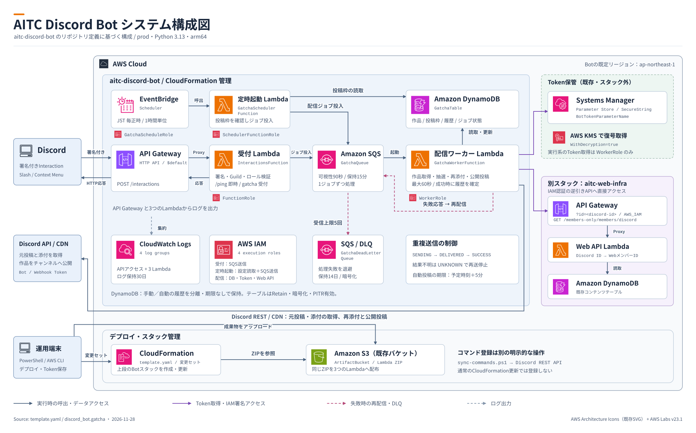

# AWSリソースの関係とシステム構成

[SVGを開く](system-architecture.svg) ／ [PNG版](system-architecture.png)

`template.yaml` と `lambda/discord_bot/gatcha/` のリポジトリ定義を図示しています。既定のBotリージョンは `ap-northeast-1`、環境はprodです。各LambdaはPython 3.13／arm64で、共通のZIPからデプロイします。

## 実行時の経路

1. Discordの署名付きInteractionをAPI Gateway HTTP APIの `POST /interactions` が受け、`InteractionsFunction` を呼び出します。受付Lambdaは署名と必要なGuild・ロール・引数を検証します。`/ping` はその場で応答し、gatchaはSQSへの投入後に受付応答を返します。
2. `GatchaQueueConsumer`（Lambdaのイベントソースマッピング）がSQSをポーリングして、`GatchaWorkerFunction` を起動します。図のSQSからワーカーへの矢印は、この連携を示します。ワーカーは最新の元投稿・添付をDiscord API／CDNから取得し、抽選して作品を公開します。
3. `GatchaHourlySchedule`（EventBridge Scheduler）はJSTの毎正時に `GatchaSchedulerFunction` を起動します。定時起動Lambdaは `GatchaTable` の投稿設定を読み、その時刻に該当する配信先ごとのジョブを、手動抽選と同じSQSへ投入します。
4. ワーカーは `GatchaTable` に作品・手動／自動の独立した履歴・ジョブ状態を読み書きします。定時起動Lambdaは投稿設定の読取だけ、受付LambdaはSQSへの送信だけを許可しています。
5. ワーカーは既存のParameter Store SecureStringからBot Tokenを復号取得します。取得先は `BotTokenParameterName` で指定します。Token値をCloudFormationやLambda環境変数へ渡しません。
6. WebメンバーIDの逆引きには、別スタックのAPI Gatewayへ直接SigV4署名で `GET /members-only/members/discord?id=<discord-id>` を送ります。この経路はAWS IAM認証を使い、CloudFrontや部員用Bearer JWTは経由しません。

## CloudFormationが管理するリソース

| 図の要素 | 主な論理ID | 関係・役割 |
| --- | --- | --- |
| HTTP API | `HttpApi`、`Integration`、`InteractionsRoute`、`Stage`、`InvokePermission` | Discordから受付Lambdaを呼び出す。API GatewayからのLambda呼出権限を限定 |
| 受付Lambda | `InteractionsFunction` | 署名検証、コマンド受付、SQS投入。Timeout 3秒 |
| 定時起動 | `GatchaHourlySchedule`、`GatchaScheduleGroup`、`GatchaSchedulerFunction` | 1時間ごとに投稿枠を確認してキューへ投入 |
| ジョブキュー | `GatchaQueue`、`GatchaQueueConsumer` | 可視性90秒、保持15分、バッチ1件、部分バッチ失敗応答を使用 |
| 配信ワーカー | `GatchaWorkerFunction` | Discord API／CDN、DynamoDB、Token取得、Web逆引きを担当。Timeout 60秒 |
| 失敗キュー | `GatchaDeadLetterQueue` | 最大受信回数5回のRedrive先。保持14日。両キューはSSE有効 |
| 作品・設定・履歴 | `GatchaTable` | 単一テーブル。オンデマンド、暗号化、PITR有効。履歴にTTLを設けず、テーブル削除時はRetain |
| ログ | `AccessLogGroup`、`FunctionLogGroup`、`WorkerLogGroup`、`SchedulerLogGroup` | APIアクセスログと3つのLambdaログ。保持30日 |

図中のCloudWatchは4つのロググループをまとめた表現です。IAMアイコンも、実行主体へのロール付与と権限分離を示します。

## IAMロールの関係

| 論理ID | 実行主体 | 主な許可 |
| --- | --- | --- |
| `FunctionRole` | 受付Lambda | 自身のログ、SQSへの送信 |
| `SchedulerFunctionRole` | 定時起動Lambda | 自身のログ、投稿設定のQuery、SQSへの送信 |
| `WorkerRole` | 配信ワーカーLambda | 自身のログ、SQS受信・削除、テーブル読取・更新、指定SSMパラメーター取得、対応するKMS復号、指定Web逆引きルートの呼出 |
| `GatchaScheduleRole` | EventBridge Scheduler | 定時起動Lambdaだけを呼び出す。信頼ポリシーを同じAWSアカウント・ScheduleGroupへ限定 |

## 再試行と重複制御

SQSの再配信によってワーカーの再試行を行います。自動投稿は予定時刻から5分を期限とし、再試行しても延長しません。送信結果が不明なら `UNKNOWN` にして再送を止めます。成功応答を保存済みの `DELIVERED` は、Discordへ再投稿せず履歴確定だけを再開します。

Schedulerによる起動失敗の再試行と、定時起動Lambdaの非同期再試行は、それぞれ最大2回・イベント期限300秒です。後者は `GatchaSchedulerRetry` で設定します。これらはSQSによる配信ワーカーの再試行とは別の設定です。詳細は [gatchaの実行・保存仕様](gatcha.md#実行と保存) を参照してください。

## 既存リソースと別スタック

- **既存SSMパラメーターとKMSキー**：Botスタックはパラメーター名と取得権限を設定します。SecureStringの保存・更新は管理スクリプトで行います。
- **既存S3成果物バケット**：`ArtifactBucket` を指定してLambda ZIPを配置します。実行時の受付・配信経路ではS3を読みません。
- **aitc-web-infra**：WebのAPI Gateway、Web API Lambda、コンテンツテーブルは別スタックです。Botは逆引きAPIのIDとリージョンを設定してアクセスします。
- **Discord／CDNと運用端末**：AWS境界の外側です。図ではDiscordの受付側とREST API／CDN側を分けて表示しています。

運用端末はZIPをS3へアップロードし、CloudFormationの変更セットを使ってBotスタックを更新します。コマンド登録は `sync-commands.ps1` による別の明示的操作です。

## 図とアイコン

SVGはアイコンを内包した単独ファイルで、拡大して表示できます。PNGはプレビュー用です。書式は `aitc-web-infra/docs/system-architecture.svg` に合わせています。

[アイコンの出典・ライセンス](architecture-icons/README.md) ／ [AWS Architecture Icons](https://aws.amazon.com/architecture/icons/)
